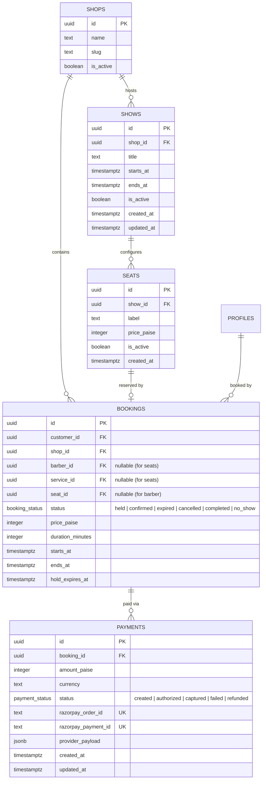
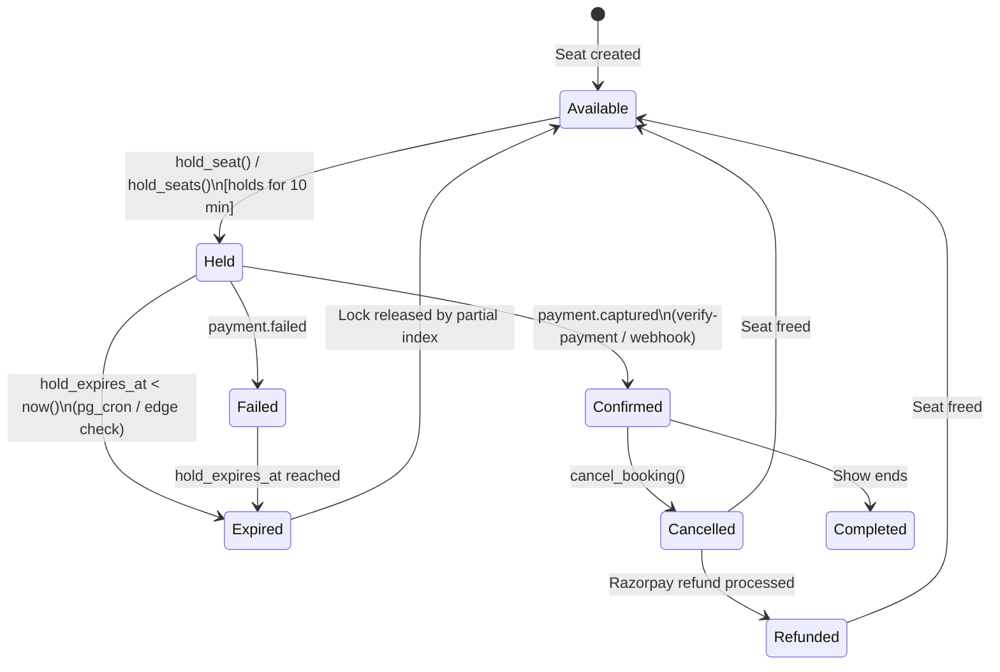
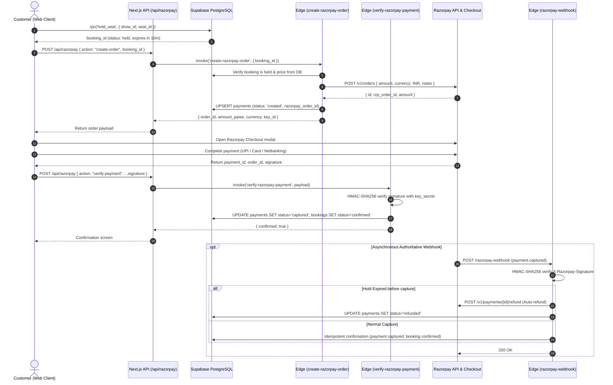

# Seat Reservation System & Razorpay Payment Architecture

> [!NOTE]
> This document specifies the production architecture, database schema, payment flow, and API contracts for Cape 001's seat reservation and Razorpay payment integration.
> 
> Seat reservations build on the core appointment foundation: events/sessions ("shows") are hosted by shops, individual seats are reserved via atomic hold locks with a 10-minute expiry window, and payments transition holds into confirmed bookings via Razorpay with guaranteed race-condition safety and automatic refunds for late captures.

---

## 1. System Architecture & Entity Relationships

The reservation engine introduces two new entity tables (`shows`, `seats`) and extends the existing `bookings` and `payments` tables with partial unique constraints and state enumerations.



### Table Definitions & Schema Constraints

1. **`shows`**
   - Scoped strictly to `shops` (`shop_id REFERENCES public.shops(id) ON DELETE CASCADE`).
   - Temporal validation: `ends_at > starts_at`.
   - Indexed on `(shop_id, starts_at)` for fast timeline queries.
   - Protected by RLS: Active shows are publicly visible (`anon`, `authenticated`) for active shops; inactive shows visible only to shop owners/managers.

2. **`seats`**
   - Belongs to a show (`show_id REFERENCES public.shows(id) ON DELETE CASCADE`).
   - Natural key uniqueness: `UNIQUE (show_id, label)`.
   - Immutable price snapshot: `price_paise >= 0`.
   - Protected by RLS: Active seats are publicly visible (`anon`, `authenticated`); mutations restricted exclusively to `SECURITY DEFINER` functions.

3. **`bookings` (Extended)**
   - Polymorphic check constraint:
     ```sql
     CONSTRAINT bookings_barber_or_seat CHECK (
       (barber_id IS NOT NULL AND service_id IS NOT NULL AND seat_id IS NULL)
       OR
       (barber_id IS NULL AND service_id IS NULL AND seat_id IS NOT NULL)
     )
     ```
   - Partial Unique Index preventing concurrent holds or duplicate bookings:
     ```sql
     CREATE UNIQUE INDEX bookings_seat_unique_active
       ON public.bookings (seat_id)
       WHERE (status IN ('held', 'confirmed') AND seat_id IS NOT NULL);
     ```

4. **`payments`**
   - Reused from core appointments with Razorpay integration.
   - Enforces positive amount constraint: `amount_paise > 0`.
   - Unique order and payment identifiers: `razorpay_order_id text UNIQUE`, `razorpay_payment_id text UNIQUE`.
   - Writes restricted to server-side functions (Edge Functions with service role).

---

## 2. Booking State Machine & Lifecycle

Every seat booking progresses through a strict, deterministic finite state machine:



### State Semantics
- **`held`**: The seat is temporarily locked for the user. A partial unique index prevents anyone else from holding or booking this seat. Valid for 10 minutes (`hold_expires_at = now() + interval '10 minutes'`).
- **`confirmed`**: Payment succeeded. `hold_expires_at` is cleared to `null`.
- **`expired`**: The 10-minute hold window elapsed before successful capture. The partial index no longer includes this row, so the seat becomes immediately available for other users.
- **`cancelled`**: Booking cancelled before cutoff.
- **`refunded`**: Online payment refunded via Razorpay Refund API.

---

## 3. Concurrency & Race-Condition Defense

Guaranteeing that concurrent users cannot double-book a seat is achieved through a multi-tier defense:

1. **Atomic In-Database Allocation**:
   - Mutations occur exclusively inside `SECURITY DEFINER` functions: `public.hold_seat(p_show_id, p_seat_id)` and `public.hold_seats(p_show_id, p_seat_ids)`.
   - Search path pinned to empty (`SET search_path = ''`) to prevent search path hijacking.
   - Explicit authentication check (`auth.uid() IS NOT NULL`).
2. **PostgreSQL Partial Unique Index**:
   - `bookings_seat_unique_active` indexes only rows `WHERE status IN ('held', 'confirmed')`.
   - If two transactions race to hold the same seat, PostgreSQL forces transaction serialization on the index. Exactly one transaction succeeds; the other triggers a `unique_violation` (23505) caught and converted into the application error `SEAT_TAKEN`.
3. **Multi-Seat All-Or-Nothing Atomicity**:
   - `hold_seats(p_show_id uuid, p_seat_ids uuid[])` loops through seat IDs in a single database transaction.
   - If any seat fails availability checks or raises `unique_violation`, the entire transaction rolls back cleanly, leaving zero partial reservations.
4. **Anti-Hoarding Seat Limits**:
   - A single customer can hold or confirm at most **6 seats** per show (`MAX_SEATS_PER_USER_PER_SHOW = 6`). Exceeding this raises `SEAT_LIMIT_REACHED`.
5. **Tamper-Proof Pricing Snapshot**:
   - Prices are read strictly from `seats.price_paise` in the database. Clients never submit prices.

---

## 4. End-to-End Payment Flow & Integration

The checkout process integrates the Next.js client, App Router API route handlers, Supabase Edge Functions, and Razorpay APIs:



---

## 5. Razorpay Route Specifications

The system provides dual-layer payment handling: Next.js Route Handlers for the client application and Supabase Edge Functions for authenticated service-role operations.

### Next.js Route Handlers

#### `POST /api/razorpay`
Central API route for client payment operations in `apps/web`.

- **Authentication**: Required (`Authorization` session cookie verified via Supabase server client).
- **Actions**:
  - `action: "create-order"`:
    - **Request Body**: `{ action: "create-order", booking_id: string (UUID) }`
    - **Response**: `{ order_id: string, amount_paise: number, currency: string, key_id: string }`
  - `action: "verify-payment"`:
    - **Request Body**: `{ action: "verify-payment", booking_id: string, razorpay_order_id: string, razorpay_payment_id: string, razorpay_signature: string }`
    - **Response**: `{ confirmed: boolean }`

#### `POST /api/razorpay/webhook`
Webhook receiver on the web host.
- Validates `X-Razorpay-Signature` against `RAZORPAY_WEBHOOK_SECRET`.
- Forwards to the Supabase Edge Function `razorpay-webhook` for execution under service-role privileges.

#### `GET /api/razorpay`
Health and discovery endpoint returning available actions and readiness status.

---

### Supabase Edge Functions

#### 1. `create-razorpay-order`
- **Location**: `supabase/functions/create-razorpay-order/index.ts`
- **Privilege**: Supabase Service Role (for reading booking status and upserting into `payments`).
- **Logic**:
  1. Verifies caller JWT and confirms `booking.customer_id === user.id`.
  2. Asserts `booking.status === 'held'` and `hold_expires_at > now()`.
  3. Reads authoritative `price_paise` snapshot from the DB row.
  4. Calls Razorpay API: `POST https://api.razorpay.com/v1/orders`.
  5. Inserts payment audit row in `public.payments` with `status = 'created'`.

#### 2. `verify-razorpay-payment`
- **Location**: `supabase/functions/verify-razorpay-payment/index.ts`
- **Logic**:
  1. Computes `HMAC-SHA256(order_id + "|" + payment_id, key_secret)`.
  2. Compares against `razorpay_signature` in constant time (`hexEqual`).
  3. Verifies booking status. If already confirmed (via webhook), returns idempotent success `{ confirmed: true }`.
  4. Updates `payments` status to `captured` and `bookings` to `confirmed`.

#### 3. `razorpay-webhook`
- **Location**: `supabase/functions/razorpay-webhook/index.ts`
- **Logic**:
  1. Computes `HMAC-SHA256(rawBody, webhook_secret)`.
  2. Compares against `X-Razorpay-Signature` in constant time.
  3. Handles `payment.captured`:
     - Looks up payment by `razorpay_order_id`.
     - Idempotency guard: If payment is already `captured` or `refunded`, returns 200 no-op.
     - **Late Capture / Auto-Refund**: If booking has `status = 'expired'` or `hold_expires_at < now()`, invokes Razorpay Refund API (`POST /v1/payments/{id}/refund`), sets payment status to `refunded`, and logs event.
     - Standard Capture: Marks payment `captured` and booking `confirmed`.
  4. Handles `payment.failed`:
     - Updates payment status to `failed`. Booking remains `held` until pg_cron expires it.

---

## 6. Shared Payment Architecture (`@cape001/core`)

Located in `packages/core/src/`:
- **`payment.ts`**: Defines the provider-agnostic `PaymentProvider` interface and Zod schemas (`createOrderRequestSchema`, `verifyPaymentRequestSchema`, `razorpayWebhookSchema`).
- **`razorpay.ts`**: Production `RazorpayPaymentProvider` implementation using standard Web Crypto (`crypto.subtle`) for universal portability across Node.js, Deno, Next.js Edge, and browser.
- **`payment-mock.ts`**: In-memory `MockPaymentProvider` for integration and unit testing without network dependencies.

```typescript
export interface PaymentProvider {
  createOrder(params: CreateOrderParams): Promise<CreateOrderResult>;
  verifySignature(params: VerifySignatureParams): boolean | Promise<boolean>;
  refund(params: RefundParams): Promise<RefundResult>;
}
```

---

## 7. Error Handling & Localized Error Codes

Database and payment errors are unified across the monorepo via `DbErrorCode` and localized in `apps/web` and `apps/partner`:

| Error Code | Meaning | User Feedback (English) |
|---|---|---|
| `SHOW_NOT_FOUND` | Show ID does not exist or shop is inactive | "We couldn't find that show." |
| `SEAT_NOT_FOUND` | Seat ID not found in show or is marked inactive | "That seat isn't available." |
| `SEAT_TAKEN` | Seat held or booked by another transaction (unique index collision) | "Sorry, someone just reserved that seat. Please pick another." |
| `SEAT_LIMIT_REACHED` | Customer exceeded 6 seats for this show | "You've reached the maximum seats per show. Cancel a hold first." |
| `HOLD_EXPIRED` | Payment attempted after 10-minute hold elapsed | "Your seat hold expired. Please start again." |

---

## 8. Expiry Automation & Background Jobs

1. **Database Cron (`pg_cron`)**:
   - Runs every 60 seconds via `cron.schedule('expire-held-bookings', '* * * * *', ...)`:
     ```sql
     UPDATE public.bookings
     SET status = 'expired'
     WHERE status = 'held'
       AND hold_expires_at < now();
     ```
2. **Edge Function Gatekeeper**:
   - `create-razorpay-order` and `verify-razorpay-payment` check `hold_expires_at < now()` before executing provider calls.
3. **Late-Capture Auto-Refund**:
   - If a customer completes Checkout right as the timer expires, the incoming webhook detects `status === 'expired'` and issues an automated Razorpay refund immediately.

---

## 9. Security & Compliance Checklist

- [x] **Zero `service_role` in Client Apps**: Neither `apps/web` nor `apps/partner` contains the service role key. Client operations use only the authenticated anon client.
- [x] **Constant-Time Verification**: All HMAC comparisons (`hexEqual`) execute in constant time to eliminate side-channel timing attacks.
- [x] **Price Tamper Resistance**: Order prices are read exclusively from database rows; client-supplied prices are strictly rejected.
- [x] **Row-Level Security (RLS)**: Public tables (`shows`, `seats`) are read-only for public/authenticated users; insert/update privileges are revoked and routed through `SECURITY DEFINER` procedures.
- [x] **Idempotent Webhooks**: Replayed Razorpay webhooks detect existing `captured`/`refunded` states and safely acknowledge with 200 OK without double-processing.

---

## 10. Resolved Design Decisions & Open Questions

All 6 architectural open questions from the initial proposal have been formally resolved:

1. **Reusing `bookings` Table**:
   - **Resolution**: Reused the existing `bookings` table by making `barber_id` and `service_id` nullable, adding `seat_id` and `hold_expires_at`, and enforcing mutual exclusion via `bookings_barber_or_seat`.
   - **Rationale**: Keeps customer booking histories, calendar displays, status transitions, and notification dispatch unified across appointment and event types without duplicating tables.

2. **Hold Duration**:
   - **Resolution**: 10 minutes (`c_hold_minutes := 10`).
   - **Rationale**: Industry-standard window balancing customer checkout completion time against inventory lockup for popular events.

3. **Maximum Seats Per User Per Show**:
   - **Resolution**: 6 seats max (`MAX_SEATS_PER_USER_PER_SHOW = 6`).
   - **Rationale**: Prevents seat hoarding and bot reservation spam while accommodating families and small groups.

4. **Partial vs All-Or-Nothing Multi-Seat Holds & Refunds**:
   - **Resolution**: Multi-seat reservation via `hold_seats` is strictly **all-or-nothing**. If any seat is taken, the transaction rolls back. Refunds for expired holds are full automatic refunds.

5. **Show Ownership Hierarchy**:
   - **Resolution**: Shows are owned directly by a `shop` (`shop_id REFERENCES public.shops(id)`).
   - **Rationale**: Aligns with Cape 001's multi-tenant shop security architecture and leverages existing shop member/owner permission models.

6. **Payment Table Reuse**:
   - **Resolution**: Reused the `public.payments` table.
   - **Rationale**: It already has `razorpay_order_id` and `razorpay_payment_id` unique columns and foreign-keys cleanly to `bookings.id`.

---

## 11. Test Coverage & Verification Matrix

| Suite | Component | Scope | Command | Status |
|---|---|---|---|---|
| **Database (pgTAP)** | `13_seat_reservation.test.sql` | 22 tests: RLS, hold_seat, hold_seats atomicity, race conditions, expiry cron, direct insert rejection | `pnpm db:test` | Ready |
| **Edge Functions** | `razorpay-webhook.test.ts` | 25 tests: Webhook signature, verify-payment signature, idempotency logic, auto-refund conditions | `pnpm test:functions` | Passing (25/25) |
| **Core Utilities** | `payment.test.ts` | 11 tests: Web Crypto HMAC-SHA256, constant-time equality, `RazorpayPaymentProvider`, `MockPaymentProvider` | `pnpm test` | Passing (60/60) |
| **Scripts** | `*.test.mjs` | 4 tests: URL validation and local database guard | `pnpm test:scripts` | Passing (4/4) |
| **Static Analysis** | Monorepo (`turbo typecheck`) | All 4 workspaces: `@cape001/core`, `@cape001/db`, `@cape001/partner`, `@cape001/web` | `pnpm typecheck` | Passing (0 errors) |
| **Code Style** | ESLint & Expo Lint | Web App & Partner Mobile App | `pnpm lint` | Passing (0 errors) |
